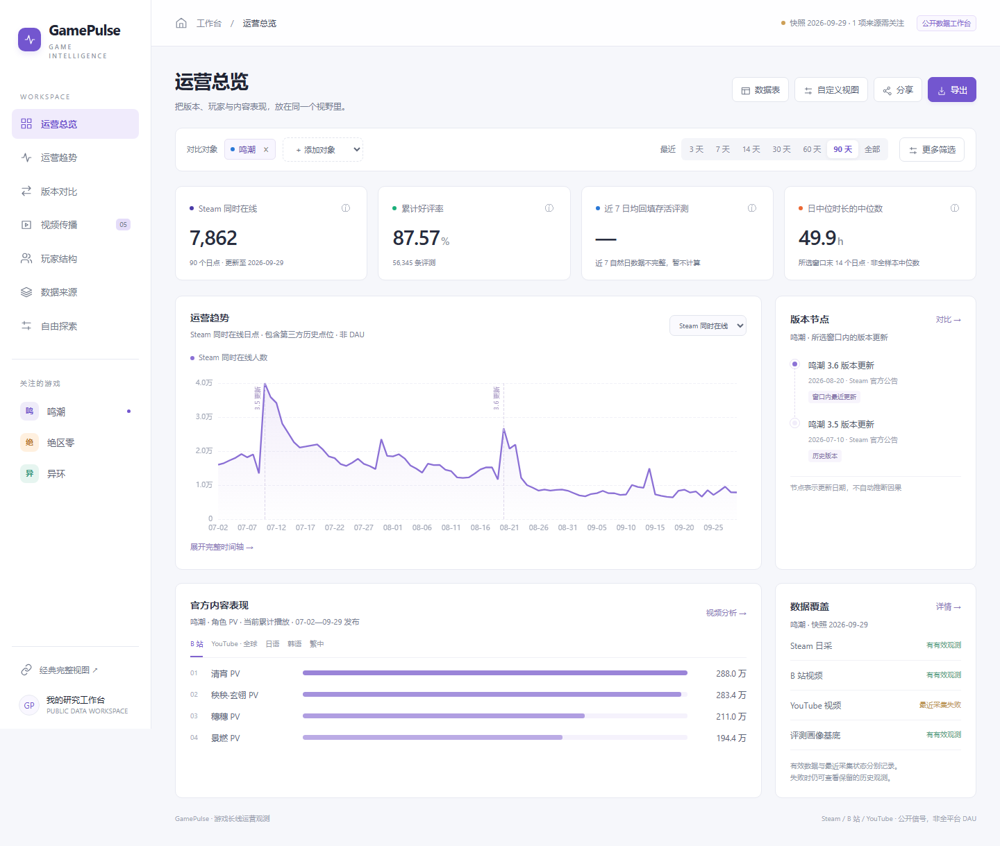

# GamePulse · 游戏长线运营情报看板

[](https://github.com/acetaffyace/Gamepulse/actions/workflows/ci.yml)

用公开的 Steam、B 站和 YouTube 数据，观察游戏版本更新前后的口碑、玩家讨论与官方内容表现。目前跟踪《鸣潮》《绝区零》《异环》。

**在线演示：** <https://acetaffyace.github.io/Gamepulse/>（静态页面，打开即用）

**30 秒了解项目：** 选一个或多个游戏、版本，按日历日期或“更新后第 N 天”对齐；在同一页面查看评测、同时在线、官方视频和版本事件，并能切换指标、导出数据。仓库自带真实采集的快照，打开页面即可查看，无需先申请 API Key 或采集数据。

## 为什么做

长线运营游戏的更新、玩家反馈和传播数据散落在多个平台。GamePulse 把这些公开信号放到同一条时间轴上，方便回答具体问题：版本更新后评测走势怎样变化？不同版本的前几天表现如何？官方视频的传播与 Steam 侧反馈是否同期变化？

它是**观察和对比工具**。事件只标记时间，图表不自动推断因果，也不把 Steam 在线人数写成 DAU。

## 主要能力

| 能力 | 实现 |
| --- | --- |
| 游戏与版本对比 | 多对象选择，按日历日期或各自起点对齐；版本窗口截到共同可比的长度 |
| 有来源的版本表 | 每个版本的开放日都附官方来源链接；公告识别结果与版本表核对，漏版、跳号进入数据质量提示 |
| 多源时间轴 | 汇集 Steam 评测、同时在线与公告；支持 3/7/14 天和自定义窗口 |
| 视频对比 | 平台/频道语区分面与叠图、同内容联动、累计/追踪增量/发布同龄/每日净增，导出 CSV/PNG |
| 玩家结构 | 从 Steam 评测明细计算评测者游戏时长与评测语种分布，展示版本前后变化 |
| 可配置看板 | 指标轨道由 YAML 定义并在构建时校验；页面可调整轨道和预设，导出 CSV、PNG 或视图链接 |
| 数据质量 | 区分直接采集、回填重建和第三方数据；缺失值保留为空；逐来源显示最近尝试、有效数据截至日期与失败原因 |

<a href="dashboard/shots/studio-overview.png"></a>

截图：[版本对比](dashboard/shots/studio-versions.png) · [视频传播](dashboard/shots/studio-videos.png) · [数据来源](dashboard/shots/studio-sources.png) · [手机版总览](dashboard/shots/studio-overview-mobile.png)

**技术实现：** Python 采集与快照构建；原始时间序列存为 JSONL，页面读取 JSON 快照；前端为原生 JavaScript + ECharts（随仓库提供，无需外网）的静态工作台。整批快照和配置校验通过后，通过原子切换索引发布。详细口径、采集链路、可靠性设计和已知限制见[技术说明](docs/technical-notes.md)。

## 本地查看

需要 Python 3.10+。在项目根目录运行：

```powershell
python -m http.server 8770 --bind 127.0.0.1
```

打开 <http://127.0.0.1:8770/dashboard/index.html>。Windows 也可以双击 `scripts\serve.cmd`。

页面：[总览](dashboard/index.html?page=overview) · [版本对比](dashboard/index.html?page=versions) · [视频传播](dashboard/index.html?page=videos) · [数据来源](dashboard/index.html?page=sources)

如需重新采集数据：

```powershell
pip install -r requirements.txt
copy .env.example .env      # 填写 YouTube API Key；境内网络再填写代理
python collect.py
```

不配置 YouTube Key 时，YouTube 采集会跳过，其他来源照常运行。Windows 计划任务的注册方式见[技术说明](docs/technical-notes.md#自动更新windows-本机)。

## 阅读数据时的边界

- Steam 同时在线只是平台某时点的人数，不代表全平台玩家数或日活。
- Steam 评测者不是全部玩家的随机样本；评测语种反映评测者选择的语言，不等于玩家所在地区。
- 视频播放量是累计值。B 站和 YouTube 的受众、统计口径不同，不合成为一个“综合热度”；多数视频是事后登记，缺少发布首周数据。
- 历史在线数据包含手工导入的第三方 SteamDB 日点；来源在看板中标注。

这是独立研究项目，不代表相关平台或游戏公司。代码以 [MIT 许可证](LICENSE) 发布；采集的数据来自各平台公开接口，其使用仍受相应平台条款约束。ECharts 按其 Apache-2.0 许可随附于 `dashboard/vendor/`。

## 验证

```powershell
python -m unittest discover -s tests -q     # Python 单元测试
npm ci; npx playwright install chromium      # 首次运行前端测试前
npm test                                     # 前后端共享公式样例
npm run test:studio                          # 工作台端到端
npm run test:browser                         # 探索视图端到端
python tools/verify_release.py               # 独立核对当前发布批次
```

每次推送到 main 时，GitHub Actions 会在 Ubuntu 与 Windows 上运行 Python 测试，并在 Ubuntu 上运行前端与浏览器测试。
