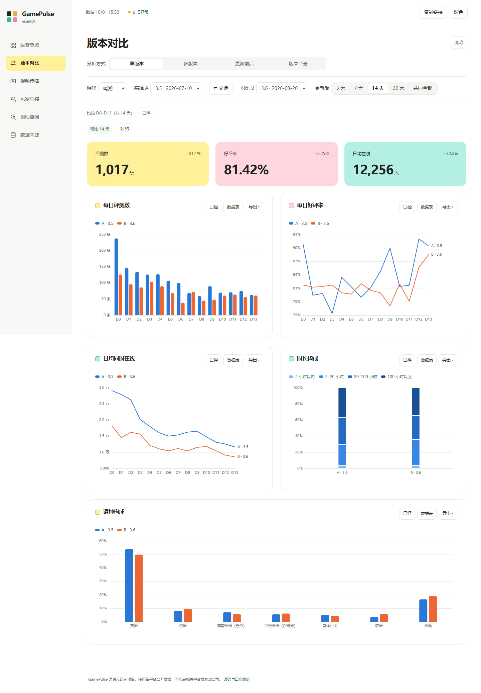

# GamePulse · 游戏长线运营看板

[](https://github.com/acetaffyace/Gamepulse/actions/workflows/ci.yml)

用 Steam、B 站和 YouTube 的公开数据，看游戏版本更新前后的评测、口碑、在线与官方视频表现，
并且可以自己选指标、维度和筛选条件做查询。目前跟踪《鸣潮》《绝区零》《异环》，
《永劫无间》端游也作为游戏接入同一套总览、版本比较、视频传播、玩家结构与自助查询。

截至 2026-10-08：鸣潮已开放 3.7，绝区零为 3.2（3.3 仍为前瞻），异环 Steam/海外版已开放 1.4。
数据于 2026-10-12 更新：四款游戏的近期评测已回补（完整日截至 10-11），Steam 汇总与双平台登记核心视频已刷新。
四款 SteamDB 日均已补齐至 10-11；永劫无间本次构建号接口未返回公开分支，保留已有值。

**在线看板：** <https://acetaffyace.github.io/Gamepulse/>（静态页面，打开即用，不需要账号）

<a href="docs/screenshots/versions.png"></a>

截图：[运营总览](docs/screenshots/overview.png) · [版本对比](docs/screenshots/versions.png) ·
[视频传播](docs/screenshots/videos.png) · [玩家结构](docs/screenshots/players.png) ·
[自助查询](docs/screenshots/explore.png) · [数据来源](docs/screenshots/sources.png) · [手机](docs/screenshots/mobile.png)

## 能做什么

| 页面 | 内容 |
|---|---|
| 运营总览 | 评测数、好评率、SteamDB 日均在线共用时间窗口；两行指标卡，日均评测、时长中位数与样本在“覆盖”中查看 |
| 版本对比 | 双版本卡片展示B与相对A的趋势，原值在“对照”中查看；支持最多6个对象同阶段、D0/日历轴、更新前后7天与版本节奏，覆盖不足不计算变化 |
| 视频传播 | 官方视频按频道语区分开；最新值排名、手选最多6支视频做同龄对比与观测覆盖检查、同一内容在各语区并排 |
| 玩家结构 | 选版本与共同阶段，查看时长P25–P75与中位数、评测语种、分组好评率和成熟评测者后续游玩；展示各自有效样本 |
| 自助查询 | 选指标 × 维度 × 筛选，现场在浏览器里计算；不合理的组合（比如跨语区相加播放量）会说明原因；也可以直接写只读 SQL |
| 数据来源 | 每个来源最近一次采集、有效数据截至哪天、是否过期，数据质量提示与口径说明 |

每张图都能切换成数据表；表格支持分页、搜索、排序，CSV导出完整结果，PNG带上统计上下文；
另可下载JSON口径说明。筛选条件存在网址里，复制链接就能分享当前视图；支持深色模式和手机。
切页和主题切换保留 SQL 草稿、展开与表格状态，链接 SQL 仍需手动运行；图表说明通过“口径”查看。

## 怎么做的

- **数据层：SQLite。** 采集器把数据写进本机的 SQLite；采集失败只记录失败，不覆盖已有的好数据；拿不到的值保持为空，不当作 0。
- **指标只定义一次。** 计算方式写在 SQL 视图和指标目录（`config/metrics.yml`）里。看板页面和自助查询都由同一个查询生成器生成 SQL，同一个数字在哪里看都一样。
- **浏览器里跑 SQL。** 发布时导出一份压缩的数据库（约 1.3 MB），网页用 [sql.js](https://github.com/sql-js/sql.js)（WebAssembly 版 SQLite）打开，任意切片都现场计算，不需要服务器。
- **前端：** 原生 ES 模块 + ECharts，没有构建步骤；浅色留白配黄、青、粉模块色，支持深色与手机布局；图形系列按对象稳定配色，沿用经过色盲友好校验的分类色。
- **发布：** 构建时先校验数据与指标目录，通过后导出发布包，推送到 `gh-pages` 分支；数据不进 main 分支，仓库不会随数据变大。

详细的架构、口径、写入规则和已知限制见 [技术说明](docs/technical-notes.md)；
排版、组件、主题与交互约定见 [界面规范](docs/interface-design.md)；
从 JSON 快照迁移到 SQLite 的设计与过程见 [数据层设计](docs/v3-data-layer.md) 和 [开发日志](docs/v3-log.md)。

参与开发时，项目约束、按需查阅入口与验证方式见 [协作约定](AGENTS.md)。

## 本地运行

需要 Python 3.10+。

```powershell
pip install -r requirements.txt
copy .env.example .env        # 填写 YouTube Key 与本机代理（可选）
python collect.py             # 采集并生成发布包 dist/
scripts\serve.cmd             # 打开 http://127.0.0.1:8770/
```

在线人数来自 SteamDB：把 SteamDB Charts 导出的 CSV 放进 `data/inbox/steamdb/`，下次采集自动导入。
Windows 也可以通过 Edge 网页自动导出（可选依赖 `pip install pywinauto`）：

```powershell
python -m tools.steamdb_edge_export --downloads-dir D:\Download
python collect.py --only steamdb
```

导出工具优先复用现有 Edge 窗口，没有可用窗口时自动启动 Edge，等待窗口就绪后使用临时标签页导出。
运行期间让 Edge 保持可操作；登录或验证由用户完成。
不读取 Cookie，不启用远程调试，也不更改浏览器配置。省略下载目录时读取本机的下载路径设置。
Windows 计划任务的注册方式见 [技术说明](docs/technical-notes.md#自动更新windows-本机)。

### 永劫无间运营面试

```powershell
python collect.py --game naraka_bladepoint
# 首次回补：以 2026-10-08 为例，含前一个补丁的完整窗口：
python collect.py --game naraka_bladepoint --only reviews --since 2026-07-02
```

在原页面游戏选择器里选择“永劫无间”，可比较有来源的补丁窗口、评测、时长与语种。
B 站与 YouTube 官方视频进入同一套登记和配对，视频传播页默认可见；
内容类型在角色/版本宣传之外支持外观、活动、联动、教学与赛事。
永劫的版本用更新日期标识；官网确认的 YouTube 全球频道独立统计，不虚设其它语区。
缺少 SteamDB 日均在线时，总览可展示已结束自然月的 SteamCharts 参考，比较表不混用两种粒度。
登记范围、来源与回补方式见 [永劫接入说明](docs/naraka-interview.md)。

## 读数时的边界

- Steam 同时在线只是 Steam 平台的人数，不代表全平台玩家数，也不是 DAU。
- 评测数按创建日统计当前仍存在的评测；评测者不是全部玩家的随机样本；评测语种是写评测时选择的语言，不等于玩家所在地区。
- 视频播放是累计观看次数；B 站和 YouTube 的受众与统计口径不同，不合成"综合热度"，同一内容的各语区版本不相加；多数视频是发布后才登记的，缺少发布初期的数据。
- 时间轴上的事件只标记时间，不推断因果。

这是独立研究项目，不代表相关平台或游戏公司。代码以 [MIT 许可证](LICENSE) 发布；数据来自各平台公开接口，使用仍受相应平台条款约束。
ECharts（Apache-2.0）与 sql.js（MIT）按各自许可随附于 `web/vendor/`。

## 测试

```powershell
python -m unittest discover -s tests -q     # Python：写入规则、SQL 视图（手算样例）、指标目录、采集器、构建、发布
npm ci; npx playwright install chromium      # 首次运行前端测试前
npm test                                     # 前端：查询生成器规则、分位数与 Python 交叉核对
npm run test:e2e                             # 端到端：用合成数据逐页检查
```

跨浏览器检查可先运行 `npx playwright install firefox webkit`，再分别设置
`$env:GP_TEST_BROWSER = 'firefox'` 或 `'webkit'` 后运行 `npm run test:e2e`；
完成后用 `Remove-Item Env:GP_TEST_BROWSER` 恢复默认 Chromium。剪贴板读取验证仅在 Chromium 自动化中运行。

推送到 main 时，GitHub Actions 在 Ubuntu 与 Windows 上运行 Python 测试，在 Ubuntu 上运行前端测试。
